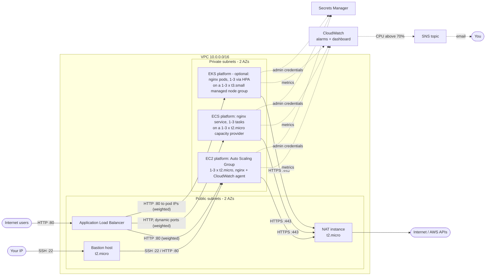

# Terraform AWS Hello World: Bastion, ALB, EC2/ECS/EKS Auto Scaling and Monitoring

A small but production-shaped AWS environment, built with Terraform to show
infrastructure-as-code best practice: a custom VPC, a bastion host, a
"Hello, World!" web tier behind an Application Load Balancer with CPU-based
auto scaling, CloudWatch monitoring with SNS alerts, a GitHub Actions pipeline
with a manually approved apply, and automated tests. It is designed to fit
within (or very close to) the AWS Free Tier.

The web tier can run on **plain EC2 (an Auto Scaling Group)**, on **ECS**, on
**EKS**, or any combination. Each platform is an independent toggle, and the
load balancer splits traffic between whichever are enabled (see
[Web platforms](#web-platforms)).

- [Architecture](#architecture)
- [How each requirement is met](#how-each-requirement-is-met)
- [Web platforms](#web-platforms)
- [Repository layout](#repository-layout)
- [Prerequisites and assumptions](#prerequisites-and-assumptions)
- [Deploying](#deploying)
- [CI/CD pipeline](#cicd-pipeline)
- [Testing the deployment](#testing-the-deployment)
- [Cost optimisation](#cost-optimisation)
- [Security notes](#security-notes)
- [Cleaning up](#cleaning-up)
- [Limitations and next steps](#limitations-and-next-steps)

## Architecture



| Component | Where | Purpose |
|---|---|---|
| VPC | 2 AZs, one public and one private `/24` per AZ | Network isolation; the ALB needs two AZs |
| Bastion host | Public subnet, t2.micro | The only SSH entry point; SSH allowed from your IP only |
| NAT instance | Public subnet, t2.micro | Outbound internet for private instances (packages, AWS APIs) without a NAT Gateway's cost |
| Application Load Balancer | Public subnets | Public entry point; forwards to every enabled platform by weight and health-checks `/health` |
| EC2 platform (`enable_ec2`) | Private subnets, t2.micro, min 1 / max 3 | nginx on an Auto Scaling Group; scales on average CPU (target 50%) |
| ECS platform (`enable_ecs`) | Private subnets, t2.micro container instances | nginx task definition and service (1-3 tasks, scaling on CPU) on an ECS cluster whose EC2 capacity provider grows the instances to fit |
| EKS platform (`enable_eks`, off by default) | Private subnets, t3.small nodes | nginx Deployment (1-3 pods via HPA) from a Helm chart; the AWS Load Balancer Controller registers pod IPs in the ALB target group |
| Secrets Manager secret | n/a | Basic-auth credentials for the `/admin/` page, shared by every platform |
| CloudWatch | n/a | CPU and memory metrics, alarms, dashboard |
| SNS topic | n/a | Emails you when an alarm fires (CPU above 70%, memory, no healthy hosts) |
| AWS Budget | n/a | Emails you at 80% of actual or 100% of forecast monthly spend |

## How each requirement is met

| Requirement | Implementation |
|---|---|
| t2.micro EC2 in a custom VPC with public and private subnets | [`modules/network`](modules/network) (wraps `terraform-aws-modules/vpc`); `instance_type` defaults to `t2.micro` everywhere |
| Bastion host in the public subnet | `module "bastion"` in [`environments/dev/main.tf`](environments/dev/main.tf), built on the generic [`modules/ec2`](modules/ec2) |
| Web server on EC2 in the private subnet | [`modules/web-asg/asg.tf`](modules/web-asg/asg.tf): launch template plus ASG in the private subnets, no public IPs |
| HTTP (80) to the web server from the bastion only | [`modules/web-asg/security_groups.tf`](modules/web-asg/security_groups.tf): web SG allows port 80 only from the bastion SG **and the ALB SG** (the ALB has to reach the targets; see [Security notes](#security-notes)) |
| SSH to the bastion from your IP | `ssh_allowed_cidrs` in [`environments/dev`](environments/dev/variables.tf): validation only accepts specific single-host `/32` IPs |
| Least-privilege IAM roles for instances | Web: publish metrics only to the `CWAgent` namespace, `ec2:DescribeTags`, and read **its own** secret ([`modules/web-asg/iam.tf`](modules/web-asg/iam.tf)). ECS: task execution role can only write its log group and read the admin secret; the nginx container gets **no** task role ([`modules/web-ecs/iam.tf`](modules/web-ecs/iam.tf)). EKS: per-service-account roles via Pod Identity; nginx's can only read the admin secret ([`modules/web-eks/pod_identity.tf`](modules/web-eks/pod_identity.tf)). Bastion: `ec2:DescribeInstances` only ([`environments/dev/main.tf`](environments/dev/main.tf)). NAT: no role at all ([`modules/ec2`](modules/ec2) only creates a role when given a policy) |
| "Hello, World!" web application | nginx page that also shows which platform, instance or task, and AZ served it |
| Automated deployment (cloud-init) | EC2: [`modules/web-asg/templates/user_data.sh.tftpl`](modules/web-asg/templates/user_data.sh.tftpl). ECS: [`modules/web-ecs/templates/start_nginx.sh.tftpl`](modules/web-ecs/templates/start_nginx.sh.tftpl) |
| ALB in front of the web server | [`modules/alb`](modules/alb): shared ALB with weighted forwarding to each enabled platform |
| ASG min 1 / max 3, triggered by CPU | [`modules/web-asg/asg.tf`](modules/web-asg/asg.tf): target-tracking policy on `ASGAverageCPUUtilization`. ECS: 1-3 tasks on `ECSServiceAverageCPUUtilization`, 1-3 instances via the capacity provider. EKS: HorizontalPodAutoscaler, 1-3 pods at 50% CPU |
| CloudWatch CPU and memory monitoring | EC2: CPU from `AWS/EC2`, memory (`mem_used_percent`) from the CloudWatch agent. ECS: CPU and memory from the free `AWS/ECS` service metrics. EKS: node CPU from `AWS/EC2` (pod metrics would need billed Container Insights). The [dashboard](modules/monitoring/dashboard.tf) shows every platform |
| Alarm when CPU is above 70%, notified via SNS | [`modules/monitoring/alarms.tf`](modules/monitoring/alarms.tf): one CPU alarm per platform, plus [`sns.tf`](modules/monitoring/sns.tf) (email subscription) |
| Free tier and cost documentation | [Cost optimisation](#cost-optimisation) |
| CI: `fmt`, `validate`, plan, apply with manual approval, test via ALB | [`.github/workflows/terraform.yml`](.github/workflows/terraform.yml) |
| **Bonus:** infrastructure testing | `terraform test` unit tests in `modules/*/tests` and `environments/dev/tests`, plus the AWS CLI/curl [`tests/smoke_test.sh`](tests/smoke_test.sh) |
| **Bonus:** Secrets Manager | `/admin/` credentials generated by Terraform as an ephemeral value and written write-only, so they're never in state ([`environments/dev/secrets.tf`](environments/dev/secrets.tf)). EC2 instances read them at boot; the ECS task definition injects them with `secrets` / `valueFrom`; on EKS the Secrets Store CSI Driver mounts them into an init container |
| **Bonus:** containerisation | nginx on Amazon ECS ([`modules/web-ecs`](modules/web-ecs)) and on Amazon EKS ([`modules/web-eks`](modules/web-eks)) |

## Web platforms

The same Hello World site (`/`, `/health` and the password-protected
`/admin/`) can be served by any combination of platforms. Each one is a module
with its own target group, and the shared load balancer forwards to every
enabled platform using weighted target groups:

| Variable | Default | Platform |
|---|---|---|
| `enable_ec2` | `true` | nginx on an EC2 Auto Scaling Group ([`modules/web-asg`](modules/web-asg)) |
| `enable_ecs` | `true` | nginx on ECS with an EC2 capacity provider ([`modules/web-ecs`](modules/web-ecs)) |
| `enable_eks` | `false` | nginx on EKS with a managed node group ([`modules/web-eks`](modules/web-eks)). Off by default because the control plane alone is ~$73/month |
| `platform_weights` | `{}` (equal) | Traffic split, e.g. `{ ec2 = 1, ecs = 3, eks = 1 }` |

At least one platform must be enabled. Running two side by side shows how you
would migrate between them with no downtime: shift the weights, then switch
the old one off. Each response names the platform that served it:

```console
$ for i in $(seq 6); do curl -s "$URL" | grep -o 'Served by [A-Z0-9]* [a-z]*'; done
Served by EC2 instance
Served by ECS task
Served by EKS pod
Served by EC2 instance
...
```

**ECS details.** The cluster's capacity provider manages a t2.micro Auto Scaling
Group (1-3 instances): ECS adds instances when tasks don't fit and protects
instances that are running tasks from scale-in. Tasks use bridge networking
with dynamic host ports, so several fit on one t2.micro. The ALB reaches them on
the ephemeral port range, and only the ALB's security group can. The image
comes from Amazon ECR Public (`nginx:stable-alpine`), which avoids Docker Hub
rate limits. The admin credentials are injected from Secrets Manager by ECS
(`secrets` / `valueFrom`). At start-up the container hashes the password into
an htpasswd file and `exec`s nginx without it, so the plaintext isn't left in
nginx's environment.

**EKS details.** A managed node group of t3.small instances runs EKS 1.36 with
AWS-managed add-ons: VPC CNI, kube-proxy, CoreDNS, the Pod Identity agent,
metrics-server (for the HPA), and the Secrets Manager provider for the Secrets
Store CSI Driver. The site is a small Helm chart
([`modules/web-eks/chart`](modules/web-eks/chart)). The AWS Load Balancer
Controller, installed with Helm and given its IAM role through Pod Identity,
reads the chart's `TargetGroupBinding` and registers **pod IPs** directly in
the Terraform-managed target group, so there's no NodePort hop. Each pod has
two containers. An init container mounts the Secrets Manager secret through
the CSI driver, using a Pod Identity role that can read only that secret, and
writes the page and an htpasswd hash to an in-memory volume. The nginx
container mounts only that volume, never the secret. It does share the pod's
Pod Identity role, because EKS injects the role's token into every container
in the pod, but that role can read only this one secret.
Access to the cluster uses EKS access entries: the CI apply role is cluster
admin, and the plan role is read-only.

**Helm values per environment.** The chart's values are layered like
`helm -f`, later layers winning:

1. [`chart/values.yaml`](modules/web-eks/chart/values.yaml): chart defaults.
2. [`environments/<env>/helm/hello-world.yaml`](environments/dev/helm/hello-world.yaml):
   that environment's overrides (replicas, autoscaling, resources, image).
3. Infrastructure wiring set by Terraform: target group, secret and service
   account. Environment files can't override these.

A `prod` environment would carry its own `helm/hello-world.yaml` (for example
`minReplicas: 2`, bigger requests) with no chart changes.

To try EKS:

```bash
terraform apply -var enable_eks=true      # ~15-20 minutes; or set it in terraform.tfvars
aws eks update-kubeconfig --name "$(terraform output -raw eks_cluster_name)"
kubectl -n hello-world get deploy,hpa,targetgroupbinding,pods
```

To turn it off again (stops the control plane charge), tear down in two steps:

```bash
# 1. Uninstall the Helm releases while the cluster is still reachable. This
#    lets the controller deregister the pods and release its finalizers.
terraform apply -destroy -var enable_eks=true \
  -target='module.web_eks[0].helm_release.app' \
  -target='module.web_eks[0].helm_release.load_balancer_controller'

# 2. Remove the cluster, nodes and the rest (~15 minutes).
terraform apply -var enable_eks=false
```

Step 1 matters because the Helm provider gets its connection from the cluster.
In a single `enable_eks=false` apply it has no cluster to talk to, so Terraform
forgets the releases instead of uninstalling them.

Your IAM identity needs cluster access for `kubectl`. The cluster creator gets
it automatically; add others with `eks_admin_principal_arns`.

## Repository layout

```
.
├── environments/
│   ├── bootstrap/           # One-time root: S3 state bucket + GitHub OIDC CI roles (local state)
│   └── dev/                 # Root module: wires the modules together, remote state, helm/ value overrides
├── modules/
│   ├── bootstrap/           # State bucket, GitHub OIDC provider, plan/apply roles
│   ├── network/             # VPC, subnets, NAT instance/gateway, S3 endpoint
│   ├── ec2/                 # Generic hardened EC2 instance (used for the bastion and NAT instance)
│   ├── alb/                 # Shared ALB: security group, weighted HTTP listener
│   ├── web-asg/             # EC2 platform: launch template, ASG, CPU scaling, cloud-init, target group
│   ├── web-ecs/             # ECS platform: cluster, capacity provider, task definition, service, target group
│   ├── web-eks/             # EKS platform: cluster, node group, add-ons, Pod Identity, LB controller, Helm chart
│   └── monitoring/          # SNS, per-platform CloudWatch alarms, dashboard, AWS Budget
│   (each module, and environments/dev, has tests/*.tftest.hcl unit tests)
├── tests/smoke_test.sh      # Post-deploy checks against the live environment
├── .github/workflows/       # CI/CD (terraform.yml) and manual teardown (destroy.yml)
└── .tflint.hcl              # TFLint rules (Terraform recommended + AWS ruleset)
```

Every directory under `environments/` is a root module (it has the provider,
backend and variable values). Everything under `modules/` is reusable and
provider-agnostic. Adding another environment (for example `staging` or `prod`)
means copying `environments/dev`, changing the backend `key`, and adjusting variables. The
modules are shared.

## Prerequisites and assumptions

- An AWS account, and credentials with administrator access for the one-time
  bootstrap. After that, CI uses scoped OIDC roles.
- [Terraform](https://developer.hashicorp.com/terraform/install) **1.11 or
  later**. The project uses S3 native state locking and write-only attributes.
  CI uses 1.12.2.
- [AWS CLI v2](https://docs.aws.amazon.com/cli/latest/userguide/getting-started-install.html),
  `curl` and `jq` for the smoke test.
- An SSH key pair. Generate one with `ssh-keygen -t ed25519` if needed.
- Region `us-east-1` by default. Any region where `t2.micro` is available works.
- HTTP only, because HTTPS would need a domain name for an ACM certificate.
  See [Limitations](#limitations-and-next-steps).

## Deploying

### 1. Bootstrap (once per AWS account)

Creates the encrypted, versioned S3 state bucket and the GitHub Actions OIDC
roles.

```bash
cd environments/bootstrap
cp terraform.tfvars.example terraform.tfvars   # set github_repository = "owner/repo"
terraform init
terraform apply
terraform output                               # note state_bucket and the two role ARNs
```

Set `create_github_oidc_provider = false` if your account already has the
GitHub OIDC provider. If your repository uses GitHub's immutable OIDC subject
format (`repo:owner@id/name@id`), set `github_oidc_subject_prefix` to the value
of `gh api repos/OWNER/REPO/actions/oidc/customization/sub --jq .sub_claim_prefix`.
Otherwise CI fails with "Not authorized to perform
sts:AssumeRoleWithWebIdentity".

### 2. Deploy the environment

```bash
cd environments/dev

cp backend.hcl.example backend.hcl             # bucket = <state_bucket output>
cp terraform.tfvars.example terraform.tfvars   # your IP, SSH public key, alarm email

terraform init -backend-config=backend.hcl
terraform plan -out=tfplan
terraform apply tfplan
```

Then:

1. **Confirm the SNS subscription.** AWS emails `alarm_email` with a
   confirmation link, and alarm notifications only arrive once you've clicked it.
2. Wait about 3-5 minutes for cloud-init and the ALB health checks, then open the
   `web_url` output.

```bash
terraform output web_url
```

## CI/CD pipeline

[`.github/workflows/terraform.yml`](.github/workflows/terraform.yml):

```
pull request ─► validate ─► plan (summary posted to the run)
push to main ─► validate ─► plan ─► ⏸ manual approval ─► apply ─► smoke test
```

| Job | What it does |
|---|---|
| **validate** | `terraform fmt -check`, `terraform validate` for every root and module, TFLint, `terraform test` (module unit tests with mocked AWS, so no credentials needed), and shellcheck |
| **plan** | Assumes the **read-only** plan role over OIDC, runs `terraform plan -detailed-exitcode`, lists the planned resource actions in the job summary, and on `main` uploads the plan file |
| **apply** | Runs in the `production` GitHub environment, so it **waits for a required reviewer to approve**. It then applies *the exact plan file that was reviewed*, using the apply role, which only trusts that environment |
| **smoke-test** | Runs [`tests/smoke_test.sh`](tests/smoke_test.sh) to confirm the app is reachable through the ALB and the infrastructure is configured as expected |

[`destroy.yml`](.github/workflows/destroy.yml) is a manual, approval-gated
teardown.

Every action is pinned to a commit SHA, and Dependabot keeps actions and
providers current. Until the repository variables below are set, only
**validate** runs, so the pipeline stays green on forks and before bootstrap.

### CI/CD setup

1. Apply the [bootstrap](#1-bootstrap-once-per-aws-account) stack.
2. **Settings → Environments → New environment** named `production`, then add
   yourself under **Required reviewers**. This is the manual approval gate.
3. Add the repository **variables** and **secrets** (Settings → Secrets and
   variables → Actions). None of these are credentials. Your IP and email are
   stored as secrets only so GitHub masks them, because a public repository's
   Actions logs are public:

   | Name | Type | Example |
   |---|---|---|
   | `AWS_REGION` | variable | `us-east-1` |
   | `TF_STATE_BUCKET` | variable | `state_bucket` output of bootstrap |
   | `AWS_PLAN_ROLE_ARN` | variable | `github_plan_role_arn` output |
   | `AWS_APPLY_ROLE_ARN` | variable | `github_apply_role_arn` output |
   | `SSH_PUBLIC_KEY` | variable | `ssh-ed25519 AAAA...` (drop the trailing comment) |
   | `SSH_ALLOWED_CIDRS` | secret | `["203.0.113.10/32"]` (HCL list) |
   | `ALARM_EMAIL` | secret | `you@example.com` |

   With the GitHub CLI:

   ```bash
   cd environments/bootstrap
   gh variable set AWS_REGION         --body us-east-1
   gh variable set TF_STATE_BUCKET    --body "$(terraform output -raw state_bucket)"
   gh variable set AWS_PLAN_ROLE_ARN  --body "$(terraform output -raw github_plan_role_arn)"
   gh variable set AWS_APPLY_ROLE_ARN --body "$(terraform output -raw github_apply_role_arn)"
   gh variable set SSH_PUBLIC_KEY     --body "$(cut -d' ' -f1,2 ~/.ssh/id_ed25519.pub)"
   gh secret set   SSH_ALLOWED_CIDRS  --body "[\"$(curl -s https://checkip.amazonaws.com)/32\"]"
   gh secret set   ALARM_EMAIL        --body you@example.com
   ```

4. Push to `main` (or run the workflow manually), review the plan, and approve
   the **Apply** job.

GitHub-hosted runners don't come from your IP, so CI can't SSH to the bastion,
and it doesn't need to: everything is configured by cloud-init.

## Testing the deployment

### Automated

```bash
# Unit tests: no AWS credentials needed, nothing is created
for d in modules/*/ environments/dev/; do (cd "$d" && terraform init -backend=false >/dev/null && terraform test); done

# Smoke test against the live environment (reads terraform outputs)
tests/smoke_test.sh environments/dev
```

The smoke test waits up to 10 minutes for the app, then checks:

- `/` returns 200 with "Hello, World!", and `/health` returns 200.
- `/admin/` returns 401 without credentials or with wrong ones, and 200 with
  the credentials from Secrets Manager, on every platform.
- nginx doesn't reveal its version.
- **Every enabled platform** actually serves requests through the ALB, and all
  of its targets are healthy.
- EC2: the ASG is min 1 / max 3 with a CPU target-tracking policy.
- ECS: the service is active and scales 1-3 tasks on CPU, and its credentials
  come from Secrets Manager.
- EKS (when enabled): the cluster and node group are active, the node group
  scales 1-3 t3.small nodes with no public IPs, and nginx has a Pod Identity
  association.
- Web servers and container instances have no public IP and are t2.micro.
- Each platform's CPU alarm threshold is 70%, and it notifies SNS.

### Manually

**Load balancer.** Refresh a few times: the page names the platform (EC2
instance or ECS task), the instance or task ID, and the AZ that served it.

```bash
curl "$(terraform -chdir=environments/dev output -raw web_url)"
```

**Admin page and Secrets Manager:**

```bash
SECRET_ARN=$(terraform -chdir=environments/dev output -raw admin_secret_arn)
aws secretsmanager get-secret-value --secret-id "$SECRET_ARN" --query SecretString --output text
curl -u admin:<password> "$(terraform -chdir=environments/dev output -raw web_url)/admin/"
```

**Bastion and private web servers:**

```bash
BASTION=$(terraform -chdir=environments/dev output -raw bastion_public_ip)
ssh ec2-user@"$BASTION"

# On the bastion: list the web servers' private IPs (the bastion role allows this)
aws ec2 describe-instances --region us-east-1 \
  --filters "Name=tag:aws:autoscaling:groupName,Values=hello-world-dev-web" "Name=instance-state-name,Values=running" \
  --query 'Reservations[].Instances[].PrivateIpAddress' --output text

curl http://<web-private-ip>/          # HTTP from the bastion is allowed
```

To SSH straight to a web server through the bastion from your machine:

```bash
ssh -J ec2-user@"$BASTION" ec2-user@<web-private-ip>
```

**ECS:**

```bash
CLUSTER=$(terraform -chdir=environments/dev output -raw ecs_cluster_name)
SERVICE=$(terraform -chdir=environments/dev output -raw ecs_service_name)
aws ecs describe-services --cluster "$CLUSTER" --services "$SERVICE" \
  --query 'services[0].{status:status,running:runningCount,desired:desiredCount,taskDefinition:taskDefinition}'
aws logs tail "/ecs/hello-world-dev/nginx" --since 30m   # container logs
```

**Negative checks.** Web servers have no public IP, so they're unreachable from
the internet. SSH to the bastion from any other IP times out.

**Scaling and the CPU alarm.** Generate load on a web server:

```bash
ssh -J ec2-user@"$BASTION" ec2-user@<web-private-ip>
sudo dnf install -y stress-ng
stress-ng --cpu 1 --timeout 20m
```

Within roughly 10-15 minutes (EC2 basic monitoring reports every 5 minutes), the
CPU alarm emails you, target tracking scales the group out (watch the
dashboard: `terraform output dashboard_url`), and it scales back in after the
load stops. t2 instances run on CPU credits, so a long stress test may be
throttled once credits are spent; that's expected.

## Cost optimisation

Everything is sized for the free tier, with paid options available as one-line
switches.

| Decision | Saving |
|---|---|
| **NAT instance (t2.micro) instead of a NAT Gateway.** Toggle with `nat_gateway_enabled = true` | NAT Gateway is about $33/month plus $0.045/GB processed |
| **t2.micro everywhere**, standard (not unlimited) CPU credits | Free-tier eligible; standard credits can't produce surprise burst charges |
| **Basic (5-minute) EC2 monitoring**, not detailed | Detailed monitoring is billed per instance |
| **Only one custom metric**: memory, aggregated per ASG rather than per instance. ECS uses the free `AWS/ECS` metrics, and Container Insights stays off | 10 custom metrics are free; per-instance dimensions would grow with scaling, and Container Insights is billed per metric |
| **ECS on an EC2 capacity provider (t2.micro), not Fargate**, with bridge networking so several tasks share an instance | Fargate isn't free-tier; an always-on 0.25 vCPU task is about $9/month |
| **ECS image from ECR Public**, 7-day log retention | No private registry to pay for; container logs don't accumulate |
| **EKS off by default**, and when on: t3.small nodes (the smallest practical size), managed add-ons, control plane logging off, no Container Insights | The control plane alone is ~$73/month and isn't free-tier. Turn it on to try it, then off again |
| **1 dashboard, 1 budget**; 5 alarms with only EC2 enabled, 12 with EC2 and ECS (including AWS-managed target-tracking alarms) | 3 dashboards, 2 budgets and 10 alarms are free; alarms beyond that are $0.10/month each |
| **8 GB gp3 volumes** for the bastion, NAT and EC2 web servers | Within the 30 GB free EBS allowance on their own. The ECS-optimized AMI needs 30 GB, so enabling ECS adds about $2.40/month of storage |
| **S3 gateway endpoint** | Free, and keeps S3 traffic off the NAT |
| **No ALB access logs, VPC flow logs or CloudWatch Logs shipping** | Avoids log storage and ingestion charges; easy to add |
| **SSE-S3 instead of KMS** for state, and **no KMS on SNS** | Avoids $1/month per customer managed key |
| **S3 native locking** (`use_lockfile`) | No DynamoDB lock table needed |
| **Single AZ NAT, minimum of 1 web server** | Smallest footprint that still demonstrates HA at the ALB/ASG layer |
| **AWS Budget alert** | Emails you before a forgotten environment becomes expensive |
| **Easy teardown**: no deletion protection, a destroy workflow | Nothing lingers after the demo |

**Running cost:**

- **Accounts on the legacy 12-month free tier:** 750 instance-hours/month
  covers one t2.micro running continuously. With only EC2 enabled the stack runs
  three (bastion, NAT, one web server), so expect about 1,460 billable hours
  (~$17/month). Enabling ECS adds one more t2.micro (~$8.50/month) plus its
  30 GB volume. The ALB (750 hours) and public IPv4 addresses (750 hours) are
  largely covered.
- **Accounts created after 15 July 2025:** AWS uses a credit-based free plan
  instead, so usage is drawn from your credits. Check which instance types are
  eligible in your account; `instance_type` is a variable if you need, say,
  `t3.micro`.
- **EKS (`enable_eks = true`) is not free-tier:** about $73/month for the
  control plane plus ~$15/month per t3.small node and its 20 GB volume. Enable
  it to explore, then disable it.
- **Paid line items regardless:**
  - Secrets Manager: $0.40/month per secret, after a 30-day trial.
  - Public IPv4: $0.005/hour each beyond the free allowance. The bastion, the
    NAT and the ALB (one per AZ) use four.

To cut costs further, stop the bastion when it isn't in use
(`aws ec2 stop-instances --instance-ids <id>`) and **destroy the environment as
soon as you're done**.

## Security notes

- **Network:** web servers live in private subnets with no public IPs. Their
  security group admits no CIDR ranges, only the ALB and bastion security
  groups. The default VPC security group has every rule removed.
- **"HTTP to the web server from the bastion only":** the requirement as
  written conflicts with putting an ALB in front of the servers, since the ALB
  must reach its targets on port 80. The web security group therefore allows
  port 80 from exactly two sources, the bastion SG and the ALB SG, and nothing
  else.
- **SSH:** only to the bastion, only from `ssh_allowed_cidrs`. Validation
  rejects `0.0.0.0/0`. Web servers accept SSH only from the bastion.
- **ECS:** container instances accept task traffic only from the ALB's security
  group (on the dynamic port range) and SSH only from the bastion. The IMDS hop
  limit of 1 stops containers on the bridge network from reaching instance
  credentials. nginx runs with no task role, so it has no AWS credentials, and
  the execution role can only write its log group and read the admin secret.
  A deployment circuit breaker rolls back task definitions that never become
  healthy.
- **EKS:** private nodes with IMDSv2 and a hop limit of 1, so pods can't use
  the node role. Each workload gets its own Pod Identity role: the LB
  controller uses the upstream least-privilege policy, and nginx can only read
  the admin secret. Pods accept HTTP only from the ALB security group. Cluster
  access is through IAM access entries only (no `aws-auth` ConfigMap). nginx
  runs with all capabilities dropped except the four it needs, and without
  privilege escalation. The API endpoint is public (authentication still
  required) because GitHub-hosted runners have no fixed IPs; restrict it with
  `endpoint_public_access_cidrs` when using self-hosted runners.
- **Instances:** IMDSv2 required (blocks SSRF-style credential theft),
  encrypted root volumes, AMIs from AWS's public SSM parameter, and nginx
  `server_tokens off`. New AMIs roll out through ASG instance refresh
  (launch-before-terminate), so instances are replaced rather than patched in
  place.
- **IAM:** each role has only what it uses (see the
  [requirement table](#how-each-requirement-is-met)). CI uses short-lived OIDC
  credentials with no stored access keys. A **read-only** role runs plans,
  including on pull requests. A separate **apply** role is assumable only from
  the approval-gated `production` environment, and its write access is limited
  to this project's services, region and name-prefixed IAM, SNS, Secrets
  Manager and Budgets resources.
- **Secrets:** the `/admin/` password is generated with an *ephemeral*
  `random_password` and stored via Secrets Manager's *write-only*
  `secret_string_wo`. It never appears in Terraform state, plan files or CI
  artifacts. EC2 instances read it at boot with their IAM role (the user-data
  script doesn't use `set -x`, so the password isn't written to logs). ECS
  injects it into the container from the task definition's `secrets`, so it's
  never in the task definition itself. Rotate it by incrementing
  `admin_password_version`.
- **State:** a private, versioned, encrypted S3 bucket that denies non-TLS
  access and has `prevent_destroy` set.

## Cleaning up

Destroy the environment first, then (optionally) the bootstrap stack.

```bash
# 1. The environment: removes everything that costs money
cd environments/dev
terraform destroy
```

Alternatively, run the **Terraform destroy** workflow in GitHub Actions: type
`destroy`, then approve.

The admin secret is scheduled for deletion with a 7-day recovery window. To
remove it immediately:

```bash
aws secretsmanager delete-secret --secret-id <admin_secret_arn> --force-delete-without-recovery
```

```bash
# 2. Optional: the bootstrap stack (state bucket, OIDC provider, CI roles).
#    The state bucket costs pennies; it's protected by prevent_destroy and
#    versioning, so empty it and lift the protection first.
cd environments/bootstrap
BUCKET=$(terraform output -raw state_bucket)
aws s3api delete-objects --bucket "$BUCKET" \
  --delete "$(aws s3api list-object-versions --bucket "$BUCKET" \
    --query '{Objects: [Versions, DeleteMarkers][][].{Key: Key, VersionId: VersionId}}' --output json)"
sed -i.bak 's/prevent_destroy = true/prevent_destroy = false/' ../../modules/bootstrap/state.tf
terraform destroy
mv ../../modules/bootstrap/state.tf.bak ../../modules/bootstrap/state.tf
```

Finally, check **Billing → Bills** a day later to confirm nothing is still
running.

## Limitations and next steps

- **HTTPS:** add a Route 53 hosted zone and an ACM certificate, then an HTTPS
  listener with an HTTP→HTTPS redirect. Skipped here because it needs a domain.
- **NAT availability:** a single NAT instance is a single point of failure for
  *outbound* traffic from the private subnets. Serving traffic through the ALB
  is unaffected. For production, set `nat_gateway_enabled = true`, or use one
  NAT per AZ.
- **Bastion vs. Session Manager:** AWS Systems Manager Session Manager could
  replace the bastion entirely (no open SSH port, IAM-audited sessions). The
  bastion is kept because the exercise asks for one.
- **ECS container instances aren't refreshed automatically.** The EC2
  platform rolls new AMIs out via instance refresh. For ECS, a new
  ECS-optimized AMI creates a new launch template version that applies to newly
  launched instances; replacing existing ones (drain, then terminate) is a
  manual or scheduled step. Fargate would remove instance management entirely,
  at a cost.
- **The EKS cluster and its Kubernetes workloads share one state**, so the Helm
  provider's connection depends on a resource in the same apply (hence the
  two-step teardown above). For production, split them: a cluster stack, and an
  apps stack or a GitOps controller (Argo CD, Flux) that deploys the chart.
- **EKS nodes don't autoscale on their own.** The HPA scales pods 1-3, and three
  nginx pods fit on one t3.small. Adding Karpenter or Cluster Autoscaler would
  let the node group follow pod demand.
- **The site is configured at start-up**, by cloud-init on EC2, a container
  entrypoint script on ECS, and an init container on EKS. A production pipeline would bake it into
  a versioned image (an AMI, or a container image in ECR) and deploy by image
  tag.
- **Observability:** ship nginx access logs to CloudWatch Logs, enable ALB
  access logs and VPC flow logs, and use 1-minute detailed monitoring for
  faster scaling. Each has a cost, which is why they're off by default.
- **Bootstrap state** stays local by design (it creates the bucket). It can be
  migrated into the bucket afterwards with a `backend "s3"` block and
  `terraform init -migrate-state`.

## License

[MIT](LICENSE)
