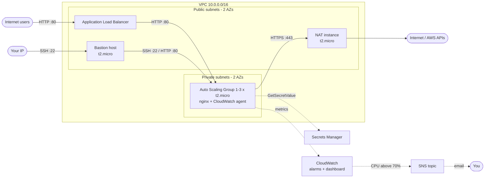

# Terraform AWS Hello World: Bastion, ALB, Auto Scaling and Monitoring

A small but production-shaped AWS environment, built with Terraform to show
infrastructure-as-code best practice: a custom VPC, a bastion host, a
"Hello, World!" web tier behind an Application Load Balancer with CPU-based
auto scaling, CloudWatch monitoring with SNS alerts, a GitHub Actions pipeline
with a manually approved apply, and automated tests. It is designed to fit
within (or very close to) the AWS Free Tier.

- [Architecture](#architecture)
- [How each requirement is met](#how-each-requirement-is-met)
- [Repository layout](#repository-layout)
- [Prerequisites and assumptions](#prerequisites-and-assumptions)
- [Deploying](#deploying)
- [CI/CD pipeline](#cicd-pipeline)
- [Testing the deployment](#testing-the-deployment)
- [Cost optimisation](#cost-optimisation)
- [Security notes](#security-notes)
- [Cleaning up](#cleaning-up)
- [Limitations and next steps](#limitations-and-next-steps)

## Architecture



| Component | Where | Purpose |
|---|---|---|
| VPC | 2 AZs, one public and one private `/24` per AZ | Network isolation; the ALB needs two AZs |
| Bastion host | Public subnet, t2.micro | The only SSH entry point; SSH allowed from your IP only |
| NAT instance | Public subnet, t2.micro | Outbound internet for private instances (packages, AWS APIs) without a NAT Gateway's cost |
| Application Load Balancer | Public subnets | Public entry point for the web app, health-checks `/health` |
| Auto Scaling Group | Private subnets, t2.micro, min 1 / max 3 | Web servers; scale on average CPU (target 50%) |
| Secrets Manager secret | n/a | Basic-auth credentials for the `/admin/` page |
| CloudWatch | n/a | CPU and memory metrics, alarms, dashboard |
| SNS topic | n/a | Emails you when an alarm fires (CPU above 70%, memory, no healthy hosts) |
| AWS Budget | n/a | Emails you at 80% of actual or 100% of forecast monthly spend |

## How each requirement is met

| Requirement | Implementation |
|---|---|
| t2.micro EC2 in a custom VPC with public and private subnets | [`modules/network`](modules/network) (wraps `terraform-aws-modules/vpc`); `instance_type` defaults to `t2.micro` everywhere |
| Bastion host in the public subnet | [`modules/bastion`](modules/bastion) |
| Web server on EC2 in the private subnet | [`modules/web/asg.tf`](modules/web/asg.tf): launch template plus ASG in the private subnets, no public IPs |
| HTTP (80) to the web server from the bastion only | [`modules/web/security_groups.tf`](modules/web/security_groups.tf): web SG allows port 80 only from the bastion SG **and the ALB SG** (the ALB has to reach the targets; see [Security notes](#security-notes)) |
| SSH to the bastion from your IP | [`modules/bastion/security_groups.tf`](modules/bastion/security_groups.tf): `ssh_allowed_cidrs`, with validation that rejects `0.0.0.0/0` |
| Least-privilege IAM roles for instances | Web: publish metrics only to the `CWAgent` namespace, `ec2:DescribeTags`, and read **its own** secret ([`modules/web/iam.tf`](modules/web/iam.tf)). Bastion: `ec2:DescribeInstances` only ([`modules/bastion/iam.tf`](modules/bastion/iam.tf)). NAT: no role |
| "Hello, World!" web application | nginx page that also shows which instance and AZ served it |
| Automated deployment (cloud-init) | [`modules/web/templates/user_data.sh.tftpl`](modules/web/templates/user_data.sh.tftpl) |
| ALB in front of the web server | [`modules/web/alb.tf`](modules/web/alb.tf) |
| ASG min 1 / max 3, triggered by CPU | [`modules/web/asg.tf`](modules/web/asg.tf): target-tracking policy on `ASGAverageCPUUtilization` |
| CloudWatch CPU and memory monitoring | CPU from `AWS/EC2`; memory (`mem_used_percent`) from the CloudWatch agent; [dashboard](modules/monitoring/dashboard.tf) |
| Alarm when CPU is above 70%, notified via SNS | [`modules/monitoring/alarms.tf`](modules/monitoring/alarms.tf) and [`sns.tf`](modules/monitoring/sns.tf) (email subscription) |
| Free tier and cost documentation | [Cost optimisation](#cost-optimisation) |
| CI: `fmt`, `validate`, plan, apply with manual approval, test via ALB | [`.github/workflows/terraform.yml`](.github/workflows/terraform.yml) |
| **Bonus:** infrastructure testing | `terraform test` unit tests in `modules/*/tests` plus the AWS CLI/curl [`tests/smoke_test.sh`](tests/smoke_test.sh) |
| **Bonus:** Secrets Manager | `/admin/` credentials generated by Terraform as an ephemeral value, written write-only (never in state), read by instances at boot ([`modules/web/secrets.tf`](modules/web/secrets.tf)) |
| **Bonus:** containerisation | Not implemented; see [Limitations](#limitations-and-next-steps) |

## Repository layout

```
.
├── environments/
│   ├── bootstrap/           # One-time root: S3 state bucket + GitHub OIDC CI roles (local state)
│   └── dev/                 # Root module: wires the modules together, remote state
├── modules/
│   ├── bootstrap/           # State bucket, GitHub OIDC provider, plan/apply roles
│   ├── network/             # VPC, subnets, NAT instance/gateway, S3 endpoint
│   ├── bastion/             # Bastion host, its security group and IAM role
│   ├── web/                 # ALB, launch template, ASG, scaling, cloud-init, secret
│   └── monitoring/          # SNS, CloudWatch alarms and dashboard, AWS Budget
│   (each module has tests/*.tftest.hcl unit tests)
├── tests/smoke_test.sh      # Post-deploy checks against the live environment
├── .github/workflows/       # CI/CD (terraform.yml) and manual teardown (destroy.yml)
└── .tflint.hcl              # TFLint rules (Terraform recommended + AWS ruleset)
```

Every directory under `environments/` is a root module (it has the provider,
backend and variable values). Everything under `modules/` is reusable and
provider-agnostic. Adding another environment (for example `staging` or `prod`)
means copying `environments/dev`, changing the backend `key`, and adjusting variables. The
modules are shared.

## Prerequisites and assumptions

- An AWS account, and credentials with administrator access for the one-time
  bootstrap. After that, CI uses scoped OIDC roles.
- [Terraform](https://developer.hashicorp.com/terraform/install) **1.11 or
  later**. The project uses S3 native state locking and write-only attributes.
  CI uses 1.12.2.
- [AWS CLI v2](https://docs.aws.amazon.com/cli/latest/userguide/getting-started-install.html),
  `curl` and `jq` for the smoke test.
- An SSH key pair. Generate one with `ssh-keygen -t ed25519` if needed.
- Region `us-east-1` by default. Any region where `t2.micro` is available works.
- HTTP only, because HTTPS would need a domain name for an ACM certificate.
  See [Limitations](#limitations-and-next-steps).

## Deploying

### 1. Bootstrap (once per AWS account)

Creates the encrypted, versioned S3 state bucket and the GitHub Actions OIDC
roles.

```bash
cd environments/bootstrap
cp terraform.tfvars.example terraform.tfvars   # set github_repository = "owner/repo"
terraform init
terraform apply
terraform output                               # note state_bucket and the two role ARNs
```

Set `create_github_oidc_provider = false` if your account already has the
GitHub OIDC provider.

### 2. Deploy the environment

```bash
cd environments/dev

cp backend.hcl.example backend.hcl             # bucket = <state_bucket output>
cp terraform.tfvars.example terraform.tfvars   # your IP, SSH public key, alarm email

terraform init -backend-config=backend.hcl
terraform plan -out=tfplan
terraform apply tfplan
```

Then:

1. **Confirm the SNS subscription.** AWS emails `alarm_email` with a
   confirmation link, and alarm notifications only arrive once you've clicked it.
2. Wait about 3-5 minutes for cloud-init and the ALB health checks, then open the
   `web_url` output.

```bash
terraform output web_url
```

## CI/CD pipeline

[`.github/workflows/terraform.yml`](.github/workflows/terraform.yml):

```
pull request ─► validate ─► plan (summary posted to the run)
push to main ─► validate ─► plan ─► ⏸ manual approval ─► apply ─► smoke test
```

| Job | What it does |
|---|---|
| **validate** | `terraform fmt -check`, `terraform validate` for every root and module, TFLint, `terraform test` (module unit tests with mocked AWS, so no credentials needed), and shellcheck |
| **plan** | Assumes the **read-only** plan role over OIDC, runs `terraform plan -detailed-exitcode`, publishes the plan to the job summary, and on `main` uploads the plan file |
| **apply** | Runs in the `production` GitHub environment, so it **waits for a required reviewer to approve**. It then applies *the exact plan file that was reviewed*, using the apply role, which only trusts that environment |
| **smoke-test** | Runs [`tests/smoke_test.sh`](tests/smoke_test.sh) to confirm the app is reachable through the ALB and the infrastructure is configured as expected |

[`destroy.yml`](.github/workflows/destroy.yml) is a manual, approval-gated
teardown.

Every action is pinned to a commit SHA, and Dependabot keeps actions and
providers current. Until the repository variables below are set, only
**validate** runs, so the pipeline stays green on forks and before bootstrap.

### CI/CD setup

1. Apply the [bootstrap](#1-bootstrap-once-per-aws-account) stack.
2. **Settings → Environments → New environment** named `production`, then add
   yourself under **Required reviewers**. This is the manual approval gate.
3. Add the repository **variables** (Settings → Secrets and variables →
   Actions → Variables). None of them are credentials:

   | Variable | Example |
   |---|---|
   | `AWS_REGION` | `us-east-1` |
   | `TF_STATE_BUCKET` | `state_bucket` output of bootstrap |
   | `AWS_PLAN_ROLE_ARN` | `github_plan_role_arn` output |
   | `AWS_APPLY_ROLE_ARN` | `github_apply_role_arn` output |
   | `SSH_ALLOWED_CIDRS` | `["203.0.113.10/32"]` (HCL list) |
   | `SSH_PUBLIC_KEY` | contents of `~/.ssh/id_ed25519.pub` |
   | `ALARM_EMAIL` | `you@example.com` |

   With the GitHub CLI:

   ```bash
   cd environments/bootstrap
   gh variable set AWS_REGION         --body us-east-1
   gh variable set TF_STATE_BUCKET    --body "$(terraform output -raw state_bucket)"
   gh variable set AWS_PLAN_ROLE_ARN  --body "$(terraform output -raw github_plan_role_arn)"
   gh variable set AWS_APPLY_ROLE_ARN --body "$(terraform output -raw github_apply_role_arn)"
   gh variable set SSH_ALLOWED_CIDRS  --body "[\"$(curl -s https://checkip.amazonaws.com)/32\"]"
   gh variable set SSH_PUBLIC_KEY     < ~/.ssh/id_ed25519.pub
   gh variable set ALARM_EMAIL        --body you@example.com
   ```

4. Push to `main` (or run the workflow manually), review the plan, and approve
   the **Apply** job.

GitHub-hosted runners don't come from your IP, so CI can't SSH to the bastion,
and it doesn't need to: everything is configured by cloud-init.

## Testing the deployment

### Automated

```bash
# Unit tests: no AWS credentials needed, nothing is created
for m in modules/*/; do (cd "$m" && terraform init -backend=false >/dev/null && terraform test); done

# Smoke test against the live environment (reads terraform outputs)
tests/smoke_test.sh environments/dev
```

The smoke test waits up to 10 minutes for the app, then checks:

- `/` returns 200 with "Hello, World!", and `/health` returns 200.
- `/admin/` returns 401 without credentials or with wrong ones, and 200 with
  the credentials from Secrets Manager.
- nginx doesn't reveal its version.
- The ASG is min 1 / max 3 with a CPU target-tracking policy.
- All targets are healthy, and web servers have no public IP and are t2.micro.
- The CPU alarm threshold is 70% and it notifies SNS.

### Manually

**Load balancer.** Refresh a few times once more than one instance is
running; the page names the instance that served it.

```bash
curl "$(terraform -chdir=environments/dev output -raw web_url)"
```

**Admin page and Secrets Manager:**

```bash
SECRET_ARN=$(terraform -chdir=environments/dev output -raw admin_secret_arn)
aws secretsmanager get-secret-value --secret-id "$SECRET_ARN" --query SecretString --output text
curl -u admin:<password> "$(terraform -chdir=environments/dev output -raw web_url)/admin/"
```

**Bastion and private web servers:**

```bash
BASTION=$(terraform -chdir=environments/dev output -raw bastion_public_ip)
ssh ec2-user@"$BASTION"

# On the bastion: list the web servers' private IPs (the bastion role allows this)
aws ec2 describe-instances --region us-east-1 \
  --filters "Name=tag:aws:autoscaling:groupName,Values=hello-world-dev-web" "Name=instance-state-name,Values=running" \
  --query 'Reservations[].Instances[].PrivateIpAddress' --output text

curl http://<web-private-ip>/          # HTTP from the bastion is allowed
```

To SSH straight to a web server through the bastion from your machine:

```bash
ssh -J ec2-user@"$BASTION" ec2-user@<web-private-ip>
```

**Negative checks.** Web servers have no public IP, so they're unreachable from
the internet. SSH to the bastion from any other IP times out.

**Scaling and the CPU alarm.** Generate load on a web server:

```bash
ssh -J ec2-user@"$BASTION" ec2-user@<web-private-ip>
sudo dnf install -y stress-ng
stress-ng --cpu 1 --timeout 20m
```

Within roughly 10-15 minutes (EC2 basic monitoring reports every 5 minutes), the
CPU alarm emails you, target tracking scales the group out (watch the
dashboard: `terraform output dashboard_url`), and it scales back in after the
load stops. t2 instances run on CPU credits, so a long stress test may be
throttled once credits are spent; that's expected.

## Cost optimisation

Everything is sized for the free tier, with paid options available as one-line
switches.

| Decision | Saving |
|---|---|
| **NAT instance (t2.micro) instead of a NAT Gateway.** Toggle with `nat_gateway_enabled = true` | NAT Gateway is about $33/month plus $0.045/GB processed |
| **t2.micro everywhere**, standard (not unlimited) CPU credits | Free-tier eligible; standard credits can't produce surprise burst charges |
| **Basic (5-minute) EC2 monitoring**, not detailed | Detailed monitoring is billed per instance |
| **Only one custom metric**: memory, aggregated per ASG rather than per instance | 10 custom metrics are free; per-instance dimensions would grow with scaling |
| **5 alarms, 1 dashboard, 1 budget** | Within the free 10 alarms, 3 dashboards and 2 budgets |
| **8 GB gp3 volumes** (3 x 8 GB) | Within the 30 GB free EBS allowance |
| **S3 gateway endpoint** | Free, and keeps S3 traffic off the NAT |
| **No ALB access logs, VPC flow logs or CloudWatch Logs shipping** | Avoids log storage and ingestion charges; easy to add |
| **SSE-S3 instead of KMS** for state, and **no KMS on SNS** | Avoids $1/month per customer managed key |
| **S3 native locking** (`use_lockfile`) | No DynamoDB lock table needed |
| **Single AZ NAT, minimum of 1 web server** | Smallest footprint that still demonstrates HA at the ALB/ASG layer |
| **AWS Budget alert** | Emails you before a forgotten environment becomes expensive |
| **Easy teardown**: no deletion protection, a destroy workflow | Nothing lingers after the demo |

**Running cost:**

- **Accounts on the legacy 12-month free tier:** 750 instance-hours/month
  covers one t2.micro running continuously. This stack runs three (bastion, NAT,
  one web server), so expect about 1,460 billable hours (~$17/month). The ALB
  (750 hours) and public IPv4 addresses (750 hours) are largely covered.
- **Accounts created after 15 July 2025:** AWS uses a credit-based free plan
  instead, so usage is drawn from your credits. Check which instance types are
  eligible in your account; `instance_type` is a variable if you need, say,
  `t3.micro`.
- **Paid line items regardless:**
  - Secrets Manager: $0.40/month per secret, after a 30-day trial.
  - Public IPv4: $0.005/hour each beyond the free allowance. The bastion, the
    NAT and the ALB (one per AZ) use four.

To cut costs further, stop the bastion when it isn't in use
(`aws ec2 stop-instances --instance-ids <id>`) and **destroy the environment as
soon as you're done**.

## Security notes

- **Network:** web servers live in private subnets with no public IPs. Their
  security group admits no CIDR ranges, only the ALB and bastion security
  groups. The default VPC security group has every rule removed.
- **"HTTP to the web server from the bastion only":** the requirement as
  written conflicts with putting an ALB in front of the servers, since the ALB
  must reach its targets on port 80. The web security group therefore allows
  port 80 from exactly two sources, the bastion SG and the ALB SG, and nothing
  else.
- **SSH:** only to the bastion, only from `ssh_allowed_cidrs`. Validation
  rejects `0.0.0.0/0`. Web servers accept SSH only from the bastion.
- **Instances:** IMDSv2 required (blocks SSRF-style credential theft),
  encrypted root volumes, AMIs from AWS's public SSM parameter, and nginx
  `server_tokens off`. New AMIs roll out through ASG instance refresh
  (launch-before-terminate), so instances are replaced rather than patched in
  place.
- **IAM:** each role has only what it uses (see the
  [requirement table](#how-each-requirement-is-met)). CI uses short-lived OIDC
  credentials with no stored access keys. A **read-only** role runs plans,
  including on pull requests. A separate **apply** role is assumable only from
  the approval-gated `production` environment, and its write access is limited
  to this project's services, region and name-prefixed IAM, SNS, Secrets
  Manager and Budgets resources.
- **Secrets:** the `/admin/` password is generated with an *ephemeral*
  `random_password` and stored via Secrets Manager's *write-only*
  `secret_string_wo`. It never appears in Terraform state, plan files or CI
  artifacts. Instances read it at boot with their IAM role; the user-data
  script doesn't use `set -x`, so the password isn't written to logs. Rotate
  it by incrementing `admin_password_version`.
- **State:** a private, versioned, encrypted S3 bucket that denies non-TLS
  access and has `prevent_destroy` set.

## Cleaning up

Destroy the environment first, then (optionally) the bootstrap stack.

```bash
# 1. The environment: removes everything that costs money
cd environments/dev
terraform destroy
```

Alternatively, run the **Terraform destroy** workflow in GitHub Actions: type
`destroy`, then approve.

The admin secret is scheduled for deletion with a 7-day recovery window. To
remove it immediately:

```bash
aws secretsmanager delete-secret --secret-id <admin_secret_arn> --force-delete-without-recovery
```

```bash
# 2. Optional: the bootstrap stack (state bucket, OIDC provider, CI roles).
#    The state bucket costs pennies; it's protected by prevent_destroy and
#    versioning, so empty it and lift the protection first.
cd environments/bootstrap
BUCKET=$(terraform output -raw state_bucket)
aws s3api delete-objects --bucket "$BUCKET" \
  --delete "$(aws s3api list-object-versions --bucket "$BUCKET" \
    --query '{Objects: [Versions, DeleteMarkers][][].{Key: Key, VersionId: VersionId}}' --output json)"
sed -i.bak 's/prevent_destroy = true/prevent_destroy = false/' ../../modules/bootstrap/state.tf
terraform destroy
mv ../../modules/bootstrap/state.tf.bak ../../modules/bootstrap/state.tf
```

Finally, check **Billing → Bills** a day later to confirm nothing is still
running.

## Limitations and next steps

- **HTTPS:** add a Route 53 hosted zone and an ACM certificate, then an HTTPS
  listener with an HTTP→HTTPS redirect. Skipped here because it needs a domain.
- **NAT availability:** a single NAT instance is a single point of failure for
  *outbound* traffic from the private subnets. Serving traffic through the ALB
  is unaffected. For production, set `nat_gateway_enabled = true`, or use one
  NAT per AZ.
- **Bastion vs. Session Manager:** AWS Systems Manager Session Manager could
  replace the bastion entirely (no open SSH port, IAM-audited sessions). The
  bastion is kept because the exercise asks for one.
- **Containerisation (bonus) is not implemented.** The natural next step is to
  build the page into an nginx image in ECR and run it on ECS Fargate behind
  the same ALB. That adds cost (Fargate isn't in the free tier) and two VPC
  endpoints or NAT traffic for image pulls.
- **Observability:** ship nginx access logs to CloudWatch Logs, enable ALB
  access logs and VPC flow logs, and use 1-minute detailed monitoring for
  faster scaling. Each has a cost, which is why they're off by default.
- **Bootstrap state** stays local by design (it creates the bucket). It can be
  migrated into the bucket afterwards with a `backend "s3"` block and
  `terraform init -migrate-state`.

## License

[MIT](LICENSE)
